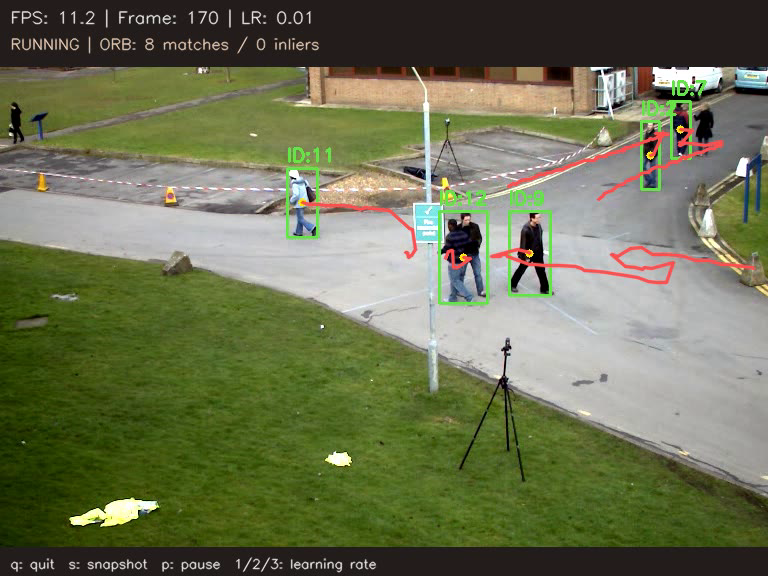
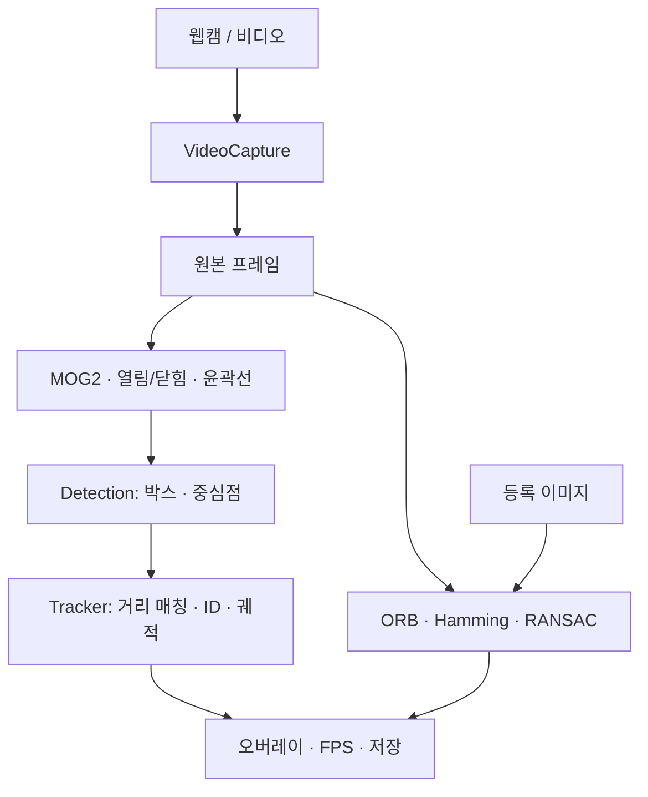

# opencv-multi-object-tracker

**OpenCV로 구현한 움직임 감지 · 다중 객체 추적 · 등록 이미지 재인식**

동영상에서 움직이는 영역을 찾고, 같은 물체에 ID를 유지하며 이동 경로를 표시하는 과정을 구현했다. MOG2 배경 차분과 중심점 거리 기반 Greedy 매칭을 사용하고, 등록 이미지의 ORB 특징을 별도로 검색한다. 겹침·정지·조명 변화 실험으로 고전적 컴퓨터 비전의 동작 조건과 한계도 분석했다.



## 최종 결과물

최종 결과물은 다음 두 가지로 구성했다.

| 결과물 | 내용 | 진입점 |
| --- | --- | --- |
| Python 비디오 분석 애플리케이션 | 웹캠/파일 입력, 움직임 감지, ID·박스·궤적·FPS 표시, 키보드 제어, ORB 재인식 | [main.py](main.py) |
| 한계 분석 보고서 | 추적 성능, 특징점 매칭, 학습률 비교, 실패 원인과 학습 기반 접근의 필요성 | [분석 보고서](docs/analysis-report.md) |

## 설치와 빠른 실행

Python **3.12**를 권장한다. 검증 환경은 Windows 11 / Python 3.12.14 / OpenCV 4.13.0 / NumPy 2.2.6이다. 저장소를 내려받은 뒤 `main.py`가 있는 폴더에서 실행한다. 데모 영상은 생성 스크립트로 만들기 때문에 외부 영상이나 웹캠 없이 시작할 수 있다.

### Windows · PowerShell

```powershell
python --version
python -m venv .venv
.\.venv\Scripts\python.exe -m pip install -r requirements.txt
.\.venv\Scripts\python.exe -m tools.generate_demo
.\.venv\Scripts\python.exe main.py --source data/demo/overlap.avi --show-mask
```

여러 Python 버전이 설치되어 있다면 첫 번째 `python`을 Python 3.12 실행 파일의 경로로 지정한다. 가상환경 활성화와 PowerShell 실행 정책 변경은 필요하지 않다.

### macOS / Linux

```bash
python3 -m venv .venv
.venv/bin/python -m pip install -r requirements.txt
.venv/bin/python -m tools.generate_demo
.venv/bin/python main.py --source data/demo/overlap.avi --show-mask
```

영상 창은 GUI가 있는 데스크톱 환경에서 실행한다. 화면이 없는 환경에서는 `--headless`를 사용한다. 다른 OS와 Python 버전의 실행 검증 범위는 [검증 문서](docs/verification.md)에 구분했다. Windows에서는 설치 후 `scripts/run-demo.cmd` 또는 `scripts/run-target-demo.cmd`를 더블클릭해도 된다.

## 사용법

아래 명령의 `python`은 가상환경의 실행 파일을 뜻한다. Windows에서는 `.\.venv\Scripts\python.exe`, macOS/Linux에서는 `.venv/bin/python`으로 실행한다.

```bash
# 등록 카드 재인식: 등장하면 TARGET DETECTED 표시
python main.py --source data/demo/target_demo.avi

# 웹캠 0번과 등록 이미지
python main.py --source 0 --target data/target.png --show-mask

# 영상 파일과 다른 등록 이미지
python main.py --source my-video.mp4 --target my-target.png --save-video

# 화면 없이 처리하고 결과 영상 저장
python main.py --source data/demo/overlap.avi --headless --save-video

# 정지 시나리오를 느린 배경 학습률로 실행
python main.py --source data/demo/stop.avi --learning-rate 0.001
```

| 키 | 동작 |
| --- | --- |
| `q` / Esc | 종료 |
| `p` | 일시정지 / 재개 |
| `s` | 현재 표시 프레임을 PNG로 저장 |
| `1` / `2` / `3` | 배경 학습률 0.001 / 0.01 / 0.1로 변경 |

키 입력은 OpenCV 영상 창에서 받는다. 정지 중에는 프레임 읽기, 배경 학습, ID 누락 카운터와 결과 영상 기록도 멈춘다. 스냅샷과 종료는 정지 중에도 사용할 수 있다.

| 주요 옵션 | 기본값 | 의미 |
| --- | --- | --- |
| `--source` | `0` | 웹캠 번호 또는 영상 경로 |
| `--target` | `data/target.png` | 재인식할 등록 이미지 한 장 |
| `--min-area` | `400` | 감지할 윤곽의 최소 면적, px² |
| `--max-distance` | `70` | 이전/현재 중심점 연결 거리, px |
| `--max-missed` | `15` | ID를 보관할 최대 연속 누락 프레임 |
| `--warmup-frames` | `30` | 배경 준비 구간 |
| `--width` | `960` | 원본이 더 넓을 때의 분석 너비 |

`--save-video`는 결과 영상 저장, `--show-mask`는 전경 마스크 표시, `--headless`는 GUI 없는 처리를 켠다. 전체 옵션은 `python main.py --help`로 확인한다. 거리와 면적은 축소된 분석 프레임 기준이다. 배경 준비 구간에는 카메라를 고정하고 빈 배경을 보여 주는 편이 좋다.

### 저장 결과

```text
outputs/<실행 시각>/
├── run.json          # 설정, 입력 FPS, OpenCV 버전
├── frames.jsonl      # 프레임별 ID·박스·누락·ORB 수치
├── annotated.avi     # --save-video 지정 시 생성
└── snapshots/        # s 키로 저장한 PNG
```

화면의 FPS는 처리·표시·저장을 포함한 실제 루프 속도다. 결과 영상의 재생 FPS는 원본을 따른다. 첫 프레임과 재개 직후에는 측정 간격이 없어 FPS가 0.0으로 표시된다.

## 처리 구조와 핵심 개념



| 단계 | 답하려는 질문 | 핵심 선택 |
| --- | --- | --- |
| 감지 | 어디가 움직였는가? | MOG2 → 그림자 제거 → 열림/닫힘 → 윤곽 면적 필터 |
| 추적 | 어느 감지가 이전 물체와 이어지는가? | 중심점 거리순 일대일 Greedy 매칭 |
| 재인식 | 등록한 무늬가 있는가? | ORB → Hamming KNN → ratio test → RANSAC |

두 중심점의 거리는 다음과 같다.

$$
d_{ij}=\sqrt{(x_i-x_j)^2+(y_i-y_j)^2}
$$

거리 문턱 안의 후보를 가까운 순서로 연결하되, 각 ID와 감지는 한 번씩만 선택한다. 새 감지에는 새 ID를 발급하고, 기존 ID는 누락 15프레임까지 보관한 뒤 16번째 연속 누락에서 삭제한다. 궤적은 최근 64개 중심점만 저장한다. ORB 결과는 Tracker의 ID 연결에 사용하지 않았다.

## 폴더 구조

```text
opencv-multi-object-tracker/
├── main.py                  # 실행 입구
├── requirements.txt         # 실행 의존성
├── object_tracker/
│   ├── app.py               # 처리 순서와 키보드 제어
│   ├── cli.py               # 옵션과 입력 검증
│   ├── models.py            # Detection / Track
│   ├── motion.py            # 배경 차분과 움직임 감지
│   ├── tracker.py           # ID 연결·수명·궤적
│   ├── target.py            # ORB 재인식
│   ├── overlay.py           # 박스·문자·경로 표시
│   ├── video_io.py          # 영상 입력과 결과 저장
│   └── evaluation.py        # 정답 기반 보조 계측
├── tools/                   # 데모 생성·실험·프레임 관찰
├── tests/                   # 추적·파이프라인·측정 기준 테스트
├── data/                    # 등록 이미지·영상 생성 정보
├── evidence/                # 측정 CSV·프레임 로그·결과 이미지
├── docs/                    # 분석 보고서·검증 기준
└── scripts/                 # Windows 실행 바로가기
```

`app.run()`에서 전체 흐름을 읽은 다음 `models.py → motion.py → tracker.py → target.py` 순서로 내려가면 된다. 감지·ID 관리·특징점 매칭·표시·입출력을 분리해 한 단계의 변경이 다른 단계로 번지는 것을 줄였다.

## 실험과 결과

각 조건은 24초(640×360, 20 FPS)의 합성 영상으로 구성했다. 이벤트 수는 단일 이동 10회, 두 객체 겹침 10회, 정지 5회, 조명 변화 5회다.

| 조건 | 이벤트 | ID Switch | 긴 누락 구간 | 실패 이벤트율 |
| --- | --- | --- | --- | --- |
| 단일 이동 | 10 | 0 | 0 | 0% |
| 두 객체 겹침 | 10 | 20 | 0 | 0% |
| 정지 | 5 | 5 | 5 | 100% |
| 조명 변화 | 5 | 0 | 1 | 20% |

ID Switch는 다른 ID가 5프레임 이상 지속된 경우, 긴 누락은 대상이 보이는데 10프레임 이상 올바른 검출이 없는 경우로 셌다. 50% 이상 가린 물체 프레임은 누락 평가에서 제외했다. 실패 이벤트율의 분모는 전체 이벤트 수다.

겹침에서는 10회 모두 두 물체의 ID가 교환됐다. 긴 누락 구간이 0이어도 정체성 연결은 틀릴 수 있으므로 두 지표를 함께 봐야 한다. 학습률 3종, 모폴로지 커널 크기 비교, 거리/누락 규칙 변경과 ORB 회전·가림 실험은 [분석 보고서](docs/analysis-report.md)에 정리했다. 실제 공개 보행자 영상은 별도 기능 점검에 사용했다.

### 재현과 프레임 관찰

```bash
python -m unittest discover -s tests -v
python -m tools.run_experiments
python -m tools.build_review_sheets
python -m tools.review_events --condition overlap
```

관찰 도구는 기본 실험의 결과 영상을 찾아 연다. 다른 영상은 `--video annotated.avi --events events.json`으로 지정한다. `a/d`는 1프레임, `j/l`은 10프레임 이동한다. `x`는 Switch, `f`는 누락 사건을 추가하고, `o`는 가림 제외 메모, `r`은 현재 계수 초기화, `s`는 저장 후 다음 이벤트다. 기록은 `evidence/manual_observations.csv`에 저장한다.

| 실험 자료 | 용도 |
| --- | --- |
| [tracking_results.csv](evidence/tracking_results.csv) | 5설정 × 4조건 집계 |
| [visual_observations.csv](evidence/visual_observations.csv) | 프레임 시트·로그를 대조한 이벤트별 관찰 |
| [automatic_observations.csv](evidence/automatic_observations.csv) | 합성 정답 좌표 기반 보조 계측 |
| [morphology_results.json](evidence/morphology_results.json) | 맥 보충 실험의 커널 5조합 × 2영상 결과 (`python -m tools.measure_morphology`로 재현) |
| [feature_results.csv](evidence/feature_results.csv) | ORB 조건별 매칭점·inlier·매칭률 |
| [검증 환경과 범위](docs/verification.md) | 테스트, 실제 영상과 GUI 점검 |

## 적용 범위

고정 카메라의 움직임을 대상으로 한다. 정지 물체의 배경 흡수, 겹침에 따른 영역 합침과 ID 교환, 급격한 조명 변화가 주요 한계다. ORB는 등록 이미지의 지역 무늬를 찾으므로 충분한 질감과 선명도가 필요하다. 합성 실험 수치를 실제 사람의 정확도로 일반화하지 않았다.

OpenCV와 NumPy, Python 표준 라이브러리로 구성했다. 딥러닝 탐지기와 `cv2.dnn`, MediaPipe는 사용하지 않았다. Hungarian·IoU 추적·Kalman 예측·침입 영역은 구현 범위에 포함하지 않았다.

## 문서와 참고 자료

- [분석 보고서](docs/analysis-report.md) · [검증 환경과 재현 방법](docs/verification.md)
- [데이터 출처](docs/analysis-report.md#11-데이터-출처)
- OpenCV 공식 문서: [배경 차분](https://docs.opencv.org/4.13.0/d1/dc5/tutorial_background_subtraction.html), [ORB](https://docs.opencv.org/4.13.0/d1/d89/tutorial_py_orb.html), [특징점 매칭](https://docs.opencv.org/4.13.0/dc/dc3/tutorial_py_matcher.html), [Homography](https://docs.opencv.org/4.13.0/d1/de0/tutorial_py_feature_homography.html)
