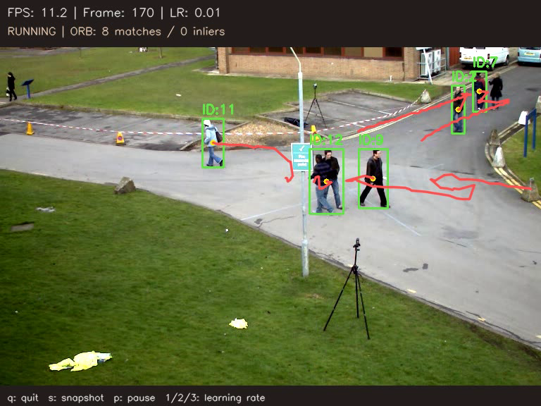

# 검증 환경과 재현 방법

애플리케이션의 실행 경로, ID 관리, ORB 재인식과 측정 기준을 아래 환경에서 검증했다. 알고리즘의 정확도 실험과 프로그램의 기능 점검을 구분했다.

## 실행 환경

| 항목 | 검증한 값 |
| --- | --- |
| OS | Windows 11 |
| Python | 3.12.14 |
| OpenCV | 4.13.0 |
| NumPy | 2.2.6 |
| 의존성 검사 | `python -m pip check` 통과 |

권장 Python 버전은 3.12다. 소스의 Python 3.8 문법 호환성은 구문 분석으로 확인했고, Python 3.8/3.9의 의존성은 `requirements.txt`에서 분기했다. 해당 버전, Python 3.14, macOS/Linux의 실제 실행은 검증 환경에 포함되지 않는다.

## 자동 테스트

프로젝트 최상위 폴더에서 가상환경의 Python으로 실행한다.

```bash
python -m unittest discover -s tests -v
```

| 대상 | 확인한 동작 |
| --- | --- |
| Tracker | ID 유지, 감지 순서 변화, 일대일 연결과 차선 후보, 거리 문턱 |
| Track 수명 | 누락 허용 횟수, 삭제 시점, ID 재사용 금지, 궤적 길이 제한 |
| 실제 영상 파이프라인 | AVI 입력 → MOG2 → ORB → 로그 → 재생 가능한 출력 AVI |
| 키보드 제어 | 정지 중 중복 처리 방지, 스냅샷, 학습률 3종 전환 |
| 입력과 데이터 | 없는 영상 경로, 무늬 없는 등록 이미지, 잘못된 수치 설정 |
| 영상 표시 | 오버레이가 분석 원본을 변경하지 않음 |
| 측정 기준 | Switch 4/5프레임, 누락 9/10프레임, 가림 50% 경계 |
| 관찰 도구 | 기본 결과 영상 선택, 이벤트별 계수 저장, 기존 기록 보존 |

집계와 실행 환경은 [verification.json](../evidence/verification.json)에 보관했다.

27개 테스트가 통과했다. 별도의 소스 사본에서도 데모 자산 생성 → 등록 카드 영상 60프레임 처리 → 출력 AVI 디코딩을 확인했다. 그 구간에서 카드 부재 40프레임의 검출은 0회, 등장 20프레임의 검출은 20회였다. 테스트용 영상과 이전 실행 결과 없이도 생성 스크립트로 입력을 준비할 수 있다.

## 합성 영상 실험

```bash
python -m tools.generate_demo
python -m tools.run_experiments
python -m tools.build_review_sheets
```

5설정 × 4조건 × 480프레임을 처리했다. 각 조건은 24초이며 기본 설정의 이벤트는 총 30개다. 학습률 0.001/0.01/0.1, 최대 거리 20/70, 최대 누락 15/40의 효과를 비교했다.

이벤트별 프레임 시트·로그 대조 기록과 정답 좌표 기반 자동 계측을 별도 CSV로 남겼다. 기본 설정의 이벤트별 Switch/누락 총계는 일치했다. 합쳐진 박스의 대응을 판정하는 방식에 따라 시작 프레임이 달라지는 예는 [분석 보고서](analysis-report.md)에 설명했다.

등록 카드의 8초 영상에서는 부재한 40프레임의 검출은 0회, 등장한 120프레임의 검출은 120회였다. 회전·가림 5조건의 특징점 결과도 별도로 저장했다.

## 실제 영상과 GUI 점검

OpenCV 공식 `vtest.avi`의 처음 240프레임(24초)을 처리하고 결과 영상을 다시 디코딩했다. 공개 보행자 영상은 기능 점검용으로 사용했으며, 정답 라벨 기반 정확도 실험은 합성 영상에서 수행했다.

| 조작 | 확인한 결과 |
| --- | --- |
| `p` | 프레임 514에서 PAUSED, 프레임 진행·학습·기록 정지 |
| 정지 상태의 `s` | 같은 프레임의 PNG 저장 |
| `1` / `2` / `3` | 같은 프레임에서 학습률 0.001 / 0.01 / 0.1 표시 |
| `p` 재개 | RUNNING으로 전환하고 프레임 515로 진행 |
| `q` | 영상·로그 저장 완료 후 창 종료 |



## 측정 범위

합성 영상의 조건별 결과와 실제 영상의 기능 점검을 평가 범위로 삼았다. 웹캠 하드웨어, 실제 보행자의 정량 정확도, 여러 환경에 대한 일반화 성능은 별도 평가가 필요하다. 한 환경의 성공을 다른 환경의 성능 보장으로 해석하지 않았다.
